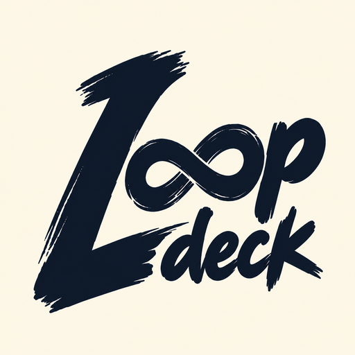
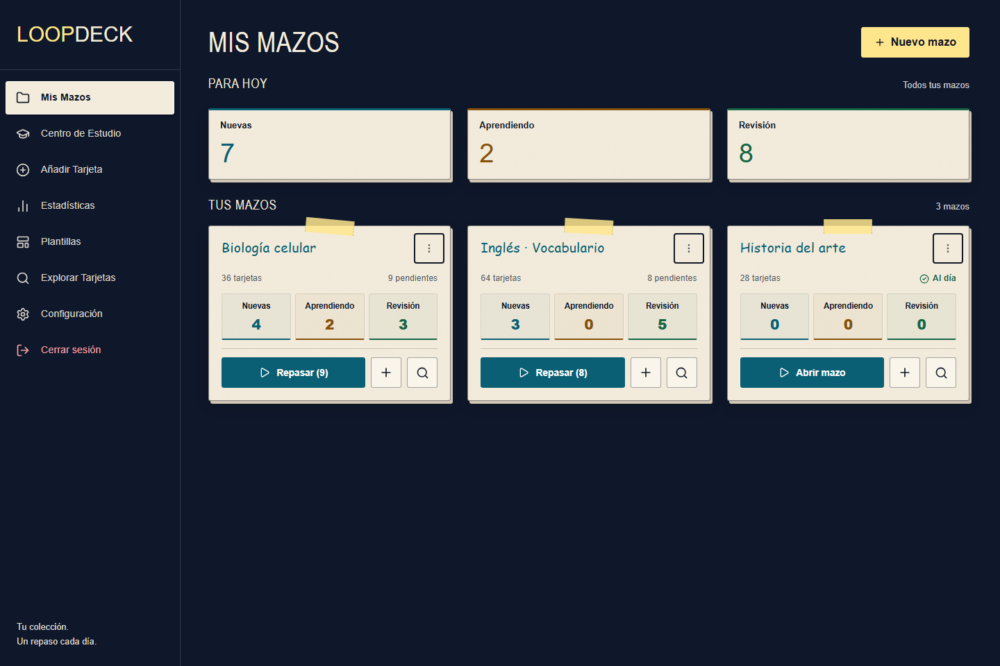
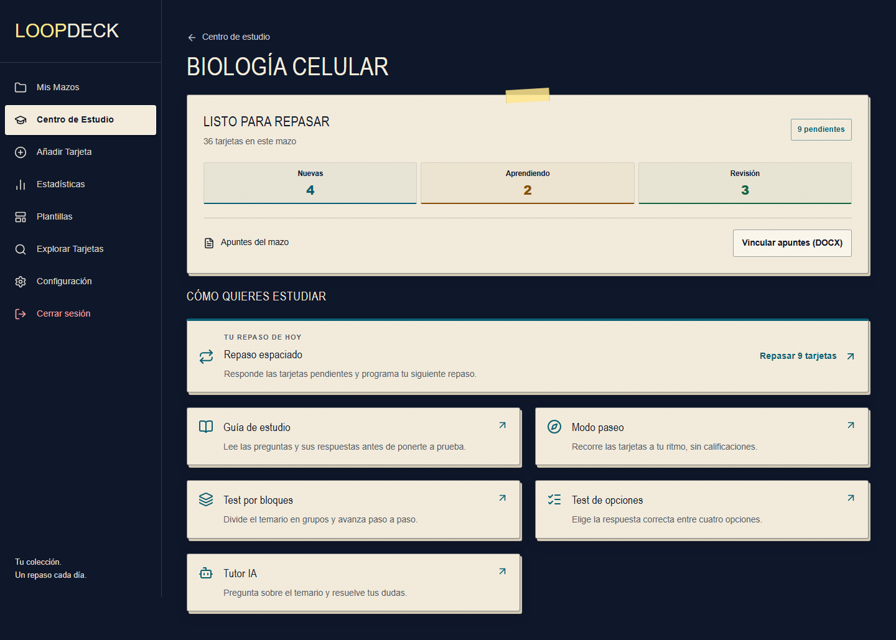

<p align="center">
  
</p>

<h1 align="center">LoopDeck</h1>

<p align="center">
  Crea tus tarjetas, estudia a tu ritmo y repasa cuando toca.<br>
  Aplicación full-stack de estudio con repetición espaciada, documentos y tutor IA.
</p>

<p align="center">
  <a href="https://loopdeck.raclos.es"><strong>Abrir la app</strong></a> ·
  <a href="#qué-puedes-hacer">Funcionalidades</a> ·
  <a href="docs/ARCHITECTURE.md">Arquitectura</a> ·
  <a href="CONTRIBUTING.md">Desarrollo local</a>
</p>

<p align="center">
  <a href="https://github.com/RaclosDev/loopdeck/actions/workflows/build.yml"></a>
  <a href="LICENSE"></a>
</p>



LoopDeck reúne la preparación del material y el repaso en una misma aplicación. Puedes crear una colección de tarjetas, consultar tus apuntes y elegir entre repaso espaciado, lectura libre o tests. Su interfaz de papel y tinta está adaptada a escritorio y móvil, y se puede instalar como PWA.

## Qué puedes hacer

| Funcionalidad                                  | Para qué sirve                                                                                                                                                                                     |
| ---------------------------------------------- | -------------------------------------------------------------------------------------------------------------------------------------------------------------------------------------------------- |
| **Mazos y tarjetas**                           | Organiza el temario en mazos y crea tarjetas de pregunta/respuesta, reversibles o con huecos (_cloze_). Añade imágenes y etiquetas, y busca contenido en el explorador.                            |
| **Repetición espaciada**                       | Repasa las tarjetas pendientes y valora cuánto te ha costado recordarlas. FSRS-5 adapta la siguiente fecha al historial de cada tarjeta; también puedes elegirla manualmente y deshacer un repaso. |
| **Cinco formas de estudiar además del repaso** | Lee preguntas y respuestas en la guía, recorre tarjetas sin calificación en el modo paseo, practica por bloques, responde tests de cuatro opciones o consulta al tutor IA.                         |
| **Apuntes junto al mazo**                      | Adjunta un documento DOCX y consúltalo desde el centro de estudio.                                                                                                                                 |
| **Ayuda de IA**                                | Genera definiciones y tarjetas a partir de listas de términos, y pregunta al tutor sobre el contenido del mazo con Google Gemini.                                                                  |
| **Plantillas y seguimiento**                   | Empieza con colecciones de capitales y banderas; consulta la distribución de tus tarjetas y lo que tienes pendiente.                                                                               |
| **Móvil y escritorio**                         | Usa la misma cuenta desde el navegador o instala la PWA. Incluye temas claro y oscuro y atajos de teclado para repasar.                                                                            |

<table>
  <tr>
    <th>Centro de estudio</th>
    <th>Repaso en móvil</th>
  </tr>
  <tr>
    <td width="72%"></td>
    <td width="28%"></td>
  </tr>
</table>

_Capturas de la interfaz real ejecutada en local con datos ficticios. Los recuentos y los intervalos son de demostración. [Cómo reproducirlas](docs/screenshots/README.md)._

## Prueba el recorrido

1. Abre [LoopDeck](https://loopdeck.raclos.es) y crea una cuenta o inicia sesión.
2. Importa una plantilla de capitales desde **Plantillas**, o crea un mazo con tus propias tarjetas.
3. Entra en el **Centro de Estudio** y elige una guía, un test o el repaso espaciado.
4. Durante el repaso, muestra la respuesta y valora el recuerdo para programar la siguiente revisión.

El estudio manual no requiere Gemini. Las funciones de IA necesitan una clave configurada en el servidor y conexión con el proveedor. La PWA no ofrece sincronización completa de repasos sin conexión.

## Tecnología

| Capa                  | Stack                                                                        |
| --------------------- | ---------------------------------------------------------------------------- |
| Interfaz              | React 19, TypeScript, Vite, TanStack Query, Zustand, Tailwind CSS y Radix UI |
| API                   | Java 17, Spring Boot 3, Spring Security, Spring Data JPA y OpenAPI           |
| Datos y planificación | PostgreSQL, migraciones Flyway y FSRS-5                                      |
| IA                    | Google Gemini, integrado desde el backend                                    |
| Pruebas               | JUnit, Testcontainers con PostgreSQL, Vitest, Testing Library y Playwright   |
| Entrega               | Docker multietapa y GitHub Actions                                           |

El proyecto cubre interfaz responsive, API autenticada, persistencia relacional, integración de IA y pruebas de navegador y base de datos. La [guía de arquitectura](docs/ARCHITECTURE.md) describe cómo se conectan estas partes y enlaza a código y pruebas representativos.

## Ejecutarlo en local

Necesitas **Node.js 22+, Java 17 y Docker** para la base de datos y los tests de integración.

```bash
git clone https://github.com/RaclosDev/loopdeck.git
cd loopdeck
```

Continúa con la [configuración paso a paso](CONTRIBUTING.md#configuración): variables de entorno, PostgreSQL, API y frontend. Allí se explican también los comandos de verificación y el flujo de contribución.

## Autor y licencia

Desarrollado por [Carlos Sanz Tomero · RaclosDev](https://github.com/RaclosDev). Código disponible bajo [licencia MIT](LICENSE).
