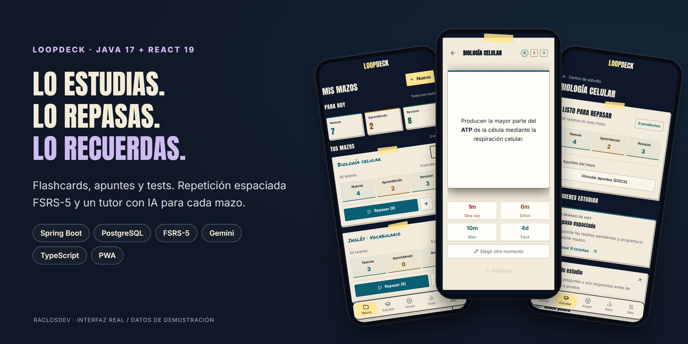
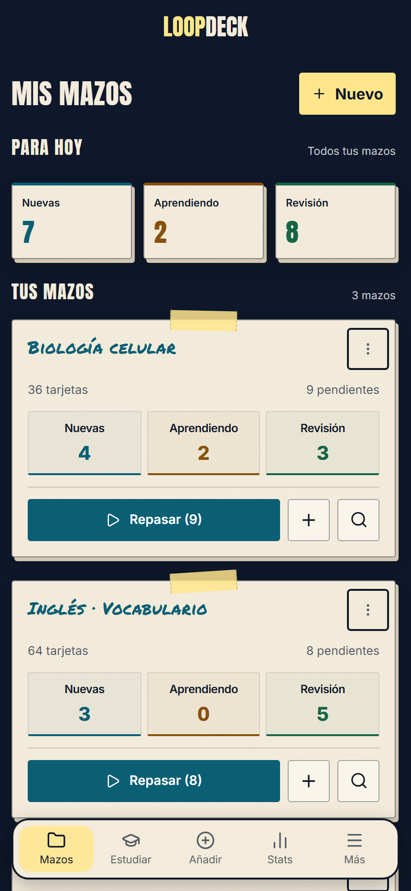
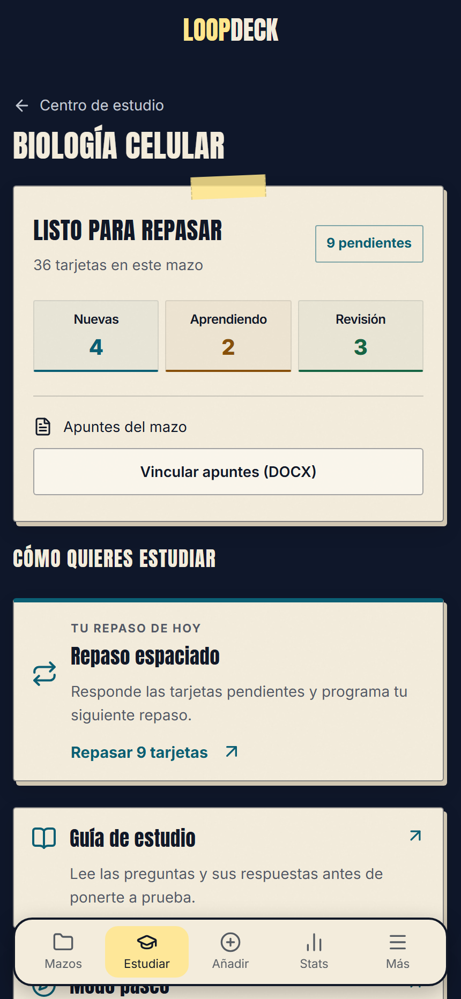
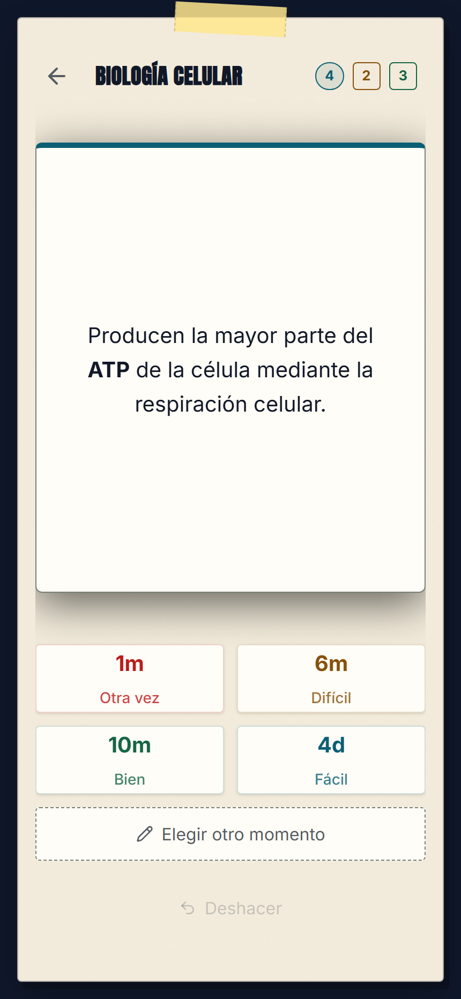

<p align="center">
  
</p>

<h1 align="center">LoopDeck</h1>

<p align="center">
  <strong>Prepara el temario. Practica. Vuelve a repasarlo cuando toca.</strong><br>
  Una PWA de estudio con flashcards, repetición espaciada, apuntes y tutor IA.
</p>

<p align="center">
  <a href="https://loopdeck.raclos.es"><strong>Abrir la app</strong></a> ·
  <a href="#qué-puedes-hacer">Funcionalidades</a> ·
  <a href="docs/ARCHITECTURE.md">Arquitectura</a> ·
  <a href="CONTRIBUTING.md">Desarrollo local</a>
</p>

<p align="center">
  <a href="https://github.com/RaclosDev/loopdeck/actions/workflows/build.yml"></a>
  <a href="LICENSE"></a>
</p>

LoopDeck reúne el material y la práctica en un mismo lugar: cada mazo contiene sus tarjetas y puede tener un documento DOCX de apoyo. El centro de estudio permite leer, practicar por bloques, hacer tests o comenzar el repaso espaciado. La siguiente revisión se calcula a partir del historial de cada tarjeta con **FSRS-5**, y también se puede programar manualmente.

Es un proyecto personal de **Carlos Sanz Tomero**, desarrollado desde el modelo de datos y la API hasta la interfaz, las pruebas y la distribución como PWA.

## La aplicación

<table>
  <tr>
    <th>Mazos y pendientes</th>
    <th>Centro de estudio</th>
    <th>Repaso y próxima revisión</th>
  </tr>
  <tr>
    <td width="33%"></td>
    <td width="33%"></td>
    <td width="33%"></td>
  </tr>
</table>

_Interfaz real capturada desde el código actual, con datos ficticios y las fuentes de la app. [Reproducir las capturas](docs/screenshots/README.md)._

## Qué puedes hacer

| Recorrido | Funcionalidades |
| --- | --- |
| **Preparar el temario** | Crea mazos y tarjetas de pregunta/respuesta, reversibles o con huecos (*cloze*). Añade imágenes y etiquetas, busca en el explorador y vincula apuntes DOCX. |
| **Elegir cómo estudiar** | Lee la guía, recorre tarjetas sin calificarlas, practica por bloques o responde tests de cuatro opciones. El tutor IA responde sobre el contenido del mazo. |
| **Repasar con continuidad** | Valora el recuerdo para que FSRS-5 programe la siguiente revisión. Puedes elegir otro intervalo y deshacer el último repaso. |
| **Preparar material con IA** | Genera definiciones y tarjetas a partir de listas de términos con Google Gemini. También hay plantillas de capitales y banderas para empezar. |
| **Seguir lo pendiente** | Consulta las tarjetas nuevas, en aprendizaje y disponibles para repaso por mazo. Usa la misma cuenta en móvil y escritorio, con temas claro y oscuro y atajos de teclado. |

## Un recorrido para probarla

1. Abre [LoopDeck](https://loopdeck.raclos.es) y entra con correo y contraseña o con Google, si está habilitado.
2. Crea un mazo o importa una colección de capitales desde **Plantillas**.
3. Entra en el **Centro de estudio** y abre una guía, un test o el repaso espaciado.
4. Muestra la respuesta y valora cuánto recuerdas, o elige una fecha de repaso manual.

Las funciones de IA necesitan Gemini configurado en el servidor; crear tarjetas y estudiar manualmente no depende de ese servicio. La app se puede instalar como PWA, pero el guardado de los repasos requiere conexión con la API.

## Decisiones técnicas

| Problema | Implementación |
| --- | --- |
| **Un contenido, varias formas de repasarlo** | Notas y tarjetas son entidades distintas: una nota reversible genera dos tarjetas con planificación independiente. [Modelo de estudio](docs/ARCHITECTURE.md#modelo-de-estudio). |
| **Reintentar un guardado sin duplicar el repaso** | Un identificador de operación, una transacción y el bloqueo de la tarjeta protegen el historial. Deshacer restaura una instantánea conservada por el servidor. [StudyReviewService](backend/src/main/java/com/loopdeck/service/StudyReviewService.java). |
| **Programar revisiones a partir del historial** | Un servicio integra la librería FSRS-5, conserva el estado de memoria y expone los intervalos al frontend. [FsrsSchedulerService](backend/src/main/java/com/loopdeck/service/FsrsSchedulerService.java). |
| **Cargar material a medida que se necesita** | El explorador pagina en servidor y el repaso solicita bloques. TanStack Query coordina consultas e invalidaciones; la sesión de estudio gestiona el avance y los fallos de guardado. [useStudySession](frontend/src/hooks/useStudySession.ts). |
| **Aislar los datos de cada cuenta** | Spring Security autentica las peticiones y los servicios comprueban la propiedad de los recursos. Las pruebas de integración ejercitan operaciones con usuarios distintos. [Pruebas de integridad](backend/src/test/java/com/loopdeck/service/DataIntegrityIntegrationTest.java). |

La [guía de arquitectura](docs/ARCHITECTURE.md) detalla el modelo, la integración de Gemini, la autenticación y los límites de la caché sin conexión.

## Stack y calidad

| Capa | Tecnologías |
| --- | --- |
| Interfaz | React 19, TypeScript, Vite, TanStack Query, Zustand, Tailwind CSS y Radix UI |
| API | Java 17, Spring Boot 3.3, Spring Security, Spring Data JPA y OpenAPI |
| Datos y planificación | PostgreSQL, migraciones Flyway y FSRS-5 |
| IA | Google Gemini, integrado desde el backend |
| Pruebas | JUnit, Testcontainers con PostgreSQL, Vitest, Testing Library y Playwright |
| Distribución | Docker multietapa, PWA y GitHub Actions |

La CI comprueba el alcance modificado, con tests de dominio, integración sobre PostgreSQL, pruebas de navegador, tipos, accesibilidad estática y umbrales de cobertura. CodeQL analiza Java y TypeScript. Los cambios exclusivamente documentales no reconstruyen toda la aplicación.

## Ejecutarlo en local

Necesitas **Node.js 22+, Java 17 y Docker** para la base de datos y los tests de integración.

```bash
git clone https://github.com/RaclosDev/loopdeck.git
cd loopdeck
```

Continúa con la [configuración paso a paso](CONTRIBUTING.md#configuración): variables de entorno, PostgreSQL, API y frontend. La misma guía recoge los comandos de verificación.

## Autor y licencia

[Carlos Sanz Tomero · RaclosDev](https://github.com/RaclosDev) · [Portfolio](https://raclosdev.github.io/) · [LinkedIn](https://www.linkedin.com/in/carlos-sanz-tomero/)

Código disponible bajo [licencia MIT](LICENSE).
