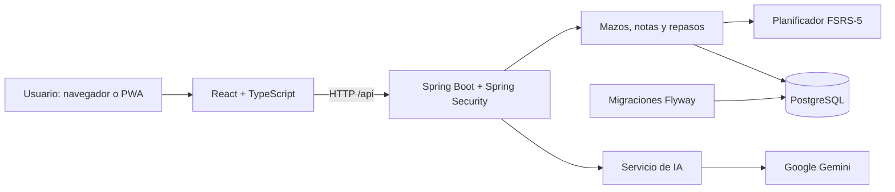

# Arquitectura de LoopDeck

[Volver al README](../README.md)

LoopDeck separa la interfaz de estudio de la API y de la planificación de repasos. El backend es un monolito Spring Boot con servicios de dominio; PostgreSQL conserva usuarios, material de estudio e historial.

## Mapa del código

| Ubicación                                                                    | Responsabilidad                                                            |
| ---------------------------------------------------------------------------- | -------------------------------------------------------------------------- |
| [`frontend/src/pages`](../frontend/src/pages)                                | Colección, editor, explorador, modos de estudio y estadísticas.            |
| [`frontend/src/components`](../frontend/src/components)                      | Tarjetas, hojas de mazo, navegación, diálogos y controles compartidos.     |
| [`frontend/src/hooks`](../frontend/src/hooks) y [`lib`](../frontend/src/lib) | Consultas, sesión de repaso, preparación de datos e invalidación de caché. |
| [`backend/.../controller`](../backend/src/main/java/com/loopdeck/controller) | Contratos HTTP y validación de entrada.                                    |
| [`backend/.../service`](../backend/src/main/java/com/loopdeck/service)       | Reglas de negocio, autorización de recursos y transacciones.               |
| [`backend/.../repository`](../backend/src/main/java/com/loopdeck/repository) | Acceso a datos con JPA y consultas específicas.                            |
| [`db/migration`](../backend/src/main/resources/db/migration)                 | Evolución versionada del esquema y de los datos.                           |

## Modelo de estudio

Una **nota** almacena el contenido y el tipo de ejercicio. Una **tarjeta** representa una dirección o un hueco concreto que se repasa y planifica de forma independiente. Así, una nota reversible puede generar dos tarjetas sin duplicar su contenido. Los **mazos** agrupan el material y las **revisiones** conservan el historial de cada tarjeta.

La integración de [FSRS-5](../backend/src/main/java/com/loopdeck/service/FsrsSchedulerService.java) calcula intervalos y mantiene el estado de memoria de cada tarjeta. La API proporciona también los intervalos que muestra la interfaz. El proyecto integra una librería de FSRS; no implementa un algoritmo propio de repetición espaciada.

## Decisiones técnicas

| Necesidad                                      | Solución y alcance                                                                                                                                                                          |
| ---------------------------------------------- | ------------------------------------------------------------------------------------------------------------------------------------------------------------------------------------------- |
| Separar contenido y progreso                   | Notas y tarjetas tienen modelos distintos. Editar el contenido no debe eliminar el historial de las tarjetas que se conservan.                                                              |
| Conservar repasos ante reintentos              | Cada acción lleva un identificador; una transacción valida la propiedad, bloquea la tarjeta y persiste revisión y planificación. Deshacer utiliza una instantánea guardada por el servidor. |
| Consultar colecciones sin descargarlas enteras | El explorador pagina en servidor y el repaso solicita bloques. La preparación anticipada limita las tarjetas por mazo y la validez de sus datos.                                            |
| Reutilizar datos en la interfaz                | TanStack Query gestiona consultas e invalidación; Zustand mantiene preferencias y estado de UI.                                                                                             |
| Integrar IA sin publicar credenciales          | El frontend llama a la API; el backend utiliza la clave de Gemini configurada por entorno y aplica tiempos de espera a las llamadas externas.                                               |
| Instalar la app sin una aplicación nativa      | Manifest y service worker permiten distribuir una PWA. La persistencia de los repasos sigue dependiendo de la API. La caché de respuestas de la API del service worker no guarda la sesión y se borra al cerrar sesión o cambiar de cuenta.                                                                          |

El acceso usa JWT y la renovación usa cookies HttpOnly limitadas a `/api/auth`. El refresh token no rota: la PWA instalada en iOS puede compartir la cookie con Safari, y rotarlo cerraría una de las dos sesiones. En su lugar, la sesión se desliza con el uso y tiene un tope de un año. Estas cookies restringen el acceso al token de renovación desde JavaScript; no equivalen a protección completa frente a XSS. El token de acceso se almacena en el navegador. Las comprobaciones de propiedad de recursos están en los servicios y se ejercitan con cuentas distintas en integración.

El guardado de repasos puede continuar en segundo plano y permite reintentos en la sesión. La cola pendiente está en memoria: no es una cola durable para cerrar el navegador y sincronizar más tarde.

## Código y pruebas para explorar

| Área                     | Implementación                                                                                  | Pruebas representativas                                                                                                                               |
| ------------------------ | ----------------------------------------------------------------------------------------------- | ----------------------------------------------------------------------------------------------------------------------------------------------------- |
| Planificación            | [FsrsSchedulerService](../backend/src/main/java/com/loopdeck/service/FsrsSchedulerService.java) | [Intervalos, estado e intervalos personalizados](../backend/src/test/java/com/loopdeck/service/FsrsSchedulerServiceTest.java)                         |
| Historial y concurrencia | [StudyReviewService](../backend/src/main/java/com/loopdeck/service/StudyReviewService.java)     | [Reintentos, deshacer, concurrencia y aislamiento entre cuentas](../backend/src/test/java/com/loopdeck/service/ReviewPersistenceIntegrationTest.java) |
| Integridad del material  | [NoteImportService](../backend/src/main/java/com/loopdeck/service/NoteImportService.java)       | [Importaciones, cloze, paginación y propiedad de mazos](../backend/src/test/java/com/loopdeck/service/DataIntegrityIntegrationTest.java)              |
| Sesión de estudio        | [useStudySession](../frontend/src/hooks/useStudySession.ts)                                     | [Estado de la sesión y fallos de guardado](../frontend/src/hooks/useStudySession.test.tsx)                                                            |
| Interfaz responsive      | [Páginas y componentes](../frontend/src/pages)                                                  | [Flujos de navegador, teclado y tamaños de pantalla](../frontend/e2e/paper-interface.spec.ts)                                                         |

Los tests de integración usan PostgreSQL con Testcontainers. Los tests de interfaz con respuestas simuladas verifican interacciones y estados, pero no sustituyen a una prueba contra un backend real. Los comandos están en [CONTRIBUTING](../CONTRIBUTING.md#verificación-según-el-cambio).

## Construcción y entrega

El [Dockerfile de la raíz](../Dockerfile) compila el frontend, lo incorpora a los recursos estáticos de Spring Boot y genera una imagen con Java 17. La base PostgreSQL se ejecuta por separado. Flyway aplica las migraciones y Hibernate valida el esquema al arrancar.

[GitHub Actions](../.github/workflows/build.yml) selecciona las comprobaciones según las rutas modificadas: backend, frontend y/o imagen Docker. La suite frontend incluye `npm audit` de dependencias de producción, lint con reglas de accesibilidad, knip, tests con umbrales de cobertura, build y Playwright; el backend, ArchUnit y una puerta de cobertura de JaCoCo. CodeQL analiza Java y TypeScript, y Dependabot propone actualizaciones semanales. Los cambios exclusivamente documentales no reconstruyen la aplicación. Este workflow valida el repositorio; no contiene un paso de despliegue a producción.
